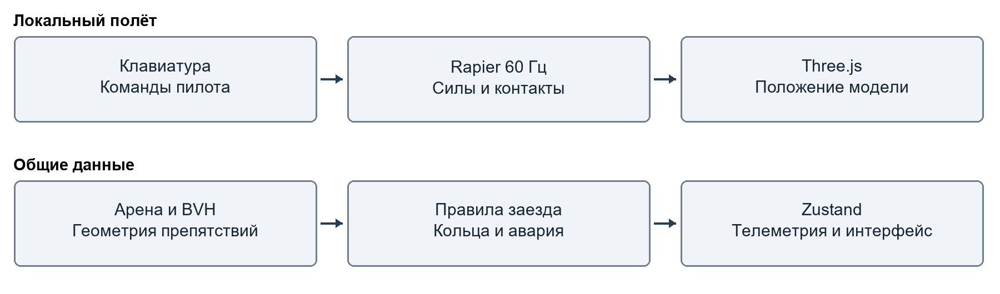
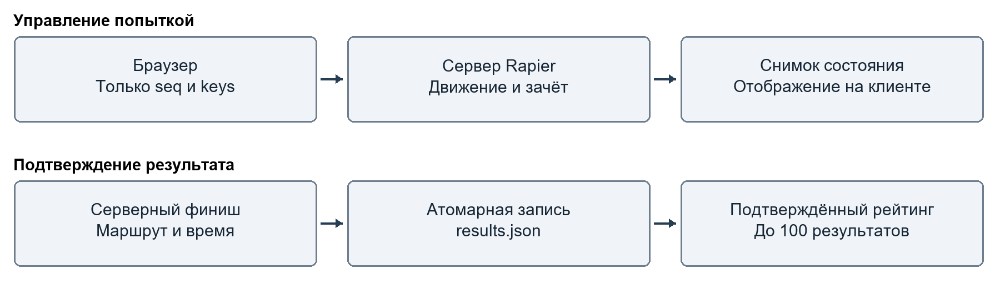

# Отчёт о реализации физической подсистемы проекта Likvi

Индивидуальный технический отчёт по проектной деятельности

Московский политехнический университет

Центр проектной деятельности

Автор: Жердин Руслан Сергеевич

Учебная группа: 241-325

Направление подготовки: 09.03.01

Руководитель проекта: Идиатуллов Тимур Тофикович

Дата состояния реализации: 13 октября 2026 года

Москва 2026

## 1 Назначение работы и полученный результат

### 1.1 Место физической подсистемы в проекте

Likvi — групповой проект браузерной платформы для виртуальных олимпиад. По паспорту проекта продукт должен объединять интерфейс соревнований, трёхмерную сцену, сетевое взаимодействие и физическую симуляцию. В реализованном прототипе участник управляет квадрокоптером на арене, тренируется в свободном полёте, проходит последовательность контрольных колец и испытывает подвижные препятствия.

Настоящий отчёт описывает зону ответственности Жердина Руслана Сергеевича: интеграцию Rapier3D, физические тела и коллайдеры, BVH, сочленения, перенос критических расчётов на сервер, связь контактов с анимациями, эффекты столкновений и проверку крайних случаев. Цель этой части — сделать движение и результат заезда следствием воспроизводимой симуляции и связать физические события с понятной визуальной реакцией.

В прототипе реализованы технические результаты всех восьми этапов физической части. В составе проекта есть управляемый динамический дрон, физическая карта препятствий, точная проверка воды, демонстрационные механизмы, отдельный серверный зачётный режим, эффекты удара и автоматические проверки. Последний полный прогон завершился результатом 48 из 48 пройденных тестов. Сборка приложения выполнена успешно; ESLint не выявил ошибок.

Серверный режим работает как самостоятельная гостевая попытка. Подключение к аккаунтам, комнатам и турнирам команды ещё требуется выполнить совместно со Степаном. Завершение индивидуальной реализации физики поэтому не означает завершения всего группового проекта или готовности публичного сервиса к промышленной эксплуатации.

### 1.2 Границы индивидуального вклада

| Участник | Область по паспорту | Связь с физической частью |
| --- | --- | --- |
| Жердин Руслан Сергеевич | Физический движок, коллизии, BVH, сочленения, серверная физика, реакции на удары, отладка | Предмет настоящего отчёта |
| Феклин Роман Евгеньевич | React, Zustand, интерфейс олимпиады, турнирная логика | Физика использует существующее хранилище и передаёт ему телеметрию, аварии и завершение попытки |
| Мухаметов Степан Владимирович | Сетевое взаимодействие, комнаты, синхронизация и устойчивость соединений | Серверный физический модуль и его протокол подготовлены для совместной интеграции |
| Кононов Руслан | Трёхмерная сцена, материалы, освещение и графическая оптимизация | Коллайдеры согласованы с геометрией; эффекты удара дополняют отображение сцены |

Интерфейс, исходная визуальная модель и общая идея платформы не включаются в индивидуальный вклад автора как разработанные с нуля. Изменения смежных компонентов связаны с подключением физики: запуск режимов, состояние аварии, сброс, подтверждение результата, показ коллайдеров и отображение физического события.

### 1.3 Сопоставление с календарным планом

В таблице приведены плановые сроки из паспорта. Они обозначают этапы задания, а не фактические даты выполнения каждого изменения. Реализация, описанная в отчёте, зафиксирована по состоянию на 13 октября 2026 года.

| Этап | Плановый период 2026 года | Реализованный результат |
| --- | --- | --- |
| 1 | 04–14 сентября | Rapier3D в React, динамический дрон, фиксированный шаг |
| 2 | 15–28 сентября | Составное тело, коллайдеры, масса, трение и упругость |
| 3 | 29 сентября – 12 октября | BVH статической геометрии, запрос поверхности и точный контур воды |
| 4 | 13–26 октября | Шарнирная створка, подъёмные ворота, ограничения и мотор |
| 5 | 27 октября – 9 ноября | Серверный расчёт движения, контактов, маршрута, времени и очков |
| 6 | 10–23 ноября | Событие аварии и анимация через react-spring |
| 7 | 24 ноября – 7 декабря | Искры, капли, круг на воде и динамическая декаль |
| 8 | 8–20 декабря | Проверки быстрых и вращательных контактов, сброса и жизненного цикла |

В календарной таблице паспорта для физической части указано имя «Жердин Иван», тогда как в составе команды записан «Жердин Руслан Сергеевич». Для данного отчёта используется запись из состава команды. Исходный паспорт не редактировался.

## 2 Архитектура и исходная проблема

### 2.1 Переход к физической модели

В исходном варианте координаты группы Three.js изменялись вручную при обновлении кадра. Проверка препятствий опиралась на пересечение сферы с увеличенными ограничивающими коробками и выполнялась с интервалом около 80 мс. Высота над землёй поддерживалась принудительным ограничением координаты. Такая схема была пригодна для демонстрации управления, но не описывала полноценное взаимодействие твёрдых тел.

В новой реализации положение и вращение дрона рассчитывает Rapier. Управление задаёт силы и моменты, а не напрямую назначает следующую координату. Физический движок вычисляет движение и контактную реакцию, Three.js отображает результат, Zustand передаёт данные интерфейсу. Это позволяет отдельно проверять симуляцию без браузера и использовать её же на сервере.

### 2.2 Разделение обязанностей

Общий слой `src/physics` содержит параметры дрона, контроллер, правила контактов, геометрию арены, запросы BVH, правила заезда и параметры эффектов. Код этого слоя не зависит от конкретного окна интерфейса. Фабрики физических объектов используются в тестах и серверной симуляции.

Клиентский слой связывает общий расчёт с жизненным циклом React. `usePhysics` обрабатывает шаги Rapier, `QuadcopterWithCollision` создаёт тело и коллайдеры, `CollisionDetector` подготавливает статическую карту. Компонент `Quadcopter` отвечает за внешний вид дрона. В серверном режиме его положение задаёт `ServerFlight` по снимкам состояния.

Серверный слой выделен в каталог `server`. Симуляция одной попытки отделена от HTTP-транспорта и хранения результатов. Такое разделение позволяет впоследствии подключить другой транспорт, сохранив правила движения и зачёта.



Рисунок 1 — Разделение расчёта, отображения и состояния интерфейса

### 2.3 Использованные версии

В таблице указаны установленные версии из локального дерева зависимостей. Для воспроизведения используется `package-lock.json`; диапазон версии в `package.json` сам по себе не гарантирует тот же набор пакетов.

| Компонент | Версия | Назначение |
| --- | --- | --- |
| React | 18.3.1 | Компоненты интерфейса и жизненный цикл |
| Three.js | 0.158.0 | Геометрия и отображение сцены |
| React Three Fiber | 8.18.0 | Связь React с Three.js |
| React Three Rapier | 1.5.0 | Тела, коллайдеры и шаги Rapier в сцене |
| Rapier3D compat | 0.14.0 | Физический движок в клиенте, сервере и тестах |
| three-mesh-bvh | 0.7.8 | Пространственные запросы по треугольникам |
| React Spring Three | 9.7.5 | Анимации, запускаемые физическими событиями |
| three-stdlib | 2.36.1 | Проекция декали через DecalGeometry |
| Zustand | 4.5.7 | Состояние режимов, телеметрии и событий |
| Vite | 5.4.21 | Разработка и сборка клиента |

## 3 Интеграция Rapier3D и управление дроном

### 3.1 Физический шаг и обновление кадра

Шаг симуляции составляет 1/60 секунды. Частота отрисовки может изменяться, но правила управления и силы применяются на физических шагах. При меньшем FPS один кадр может включать несколько шагов симуляции. При большем FPS изображение интерполируется между рассчитанными состояниями.

В `useBeforePhysicsStep` проверяется необходимость сброса, читаются команды пилота, сохраняются скорости перед контактом и применяется контроллер. В `useAfterPhysicsStep` проверяются контакты, вода, границы арены и прохождение кольца. Обычная телеметрия публикуется раз в три шага, то есть примерно с частотой 20 Гц. Авария и завершение полёта передаются без ожидания этого интервала.

Отдельные тесты выполняют одинаковую последовательность команд при условных 30, 60 и 120 кадрах в секунду. При равном числе физических шагов получаются одинаковые координаты, скорости и вращение. Это подтверждает независимость проверенного сценария от частоты отрисовки в одной среде.

Документация Rapier связывает детерминированность с одинаковыми версиями, начальными параметрами и порядком создания объектов [3]. В проекте используются также вычисления JavaScript, включая тригонометрические функции. Полная межбраузерная идентичность всей прикладной модели отдельно не проверялась; в зачётном режиме результат определяет один сервер.

### 3.2 Система координат и параметры

Используются метры, секунды, килограммы, ньютоны и радианы. Ось Y направлена вверх. Основное направление прохождения маршрута — отрицательное направление Z. Скорость для интерфейса переводится из м/с в км/ч умножением на 3,6.

| Параметр | Значение |
| --- | --- |
| Масса дрона | 1 кг |
| Ускорение свободного падения | 9,81 м/с² |
| Максимальная тяга | 27,2 Н |
| Шаг симуляции | 1/60 с |
| Газ для зависания без наклона | Около 0,361 или 36,1% |
| Максимальный целевой наклон | 0,52 рад или около 29,8° |
| Максимальная скорость изменения целевого курса | 1,5 рад/с |
| Ограничение управляющего момента | 8 Н·м по длине вектора |
| Начальная позиция обычного полёта | X = 0 м, Y = 0,86 м, Z = 0 м |
| Горизонтальные границы арены | От −420 до 420 м по X и Z |
| Контроль вертикальных границ | Авария ниже −5 м или выше 300 м |
| Итерации решателя | 8 |
| Максимум подшагов CCD | 4 |

### 3.3 Подъёмная сила и сопротивление

Газ ограничен интервалом от 0 до 1. Тяга направлена вдоль локальной вертикали дрона, поэтому наклон создаёт горизонтальную составляющую. Для перевода силы в мировые координаты используется текущий кватернион ориентации.

Формула тяги в локальных координатах: F = (0; 27,2u; 0), где u — газ. Условие зависания горизонтально ориентированного аппарата: 27,2u = mg. При массе 1 кг получаем u = 9,81 / 27,2 ≈ 0,361.

Сопротивление воздуха зависит от линейной скорости. По X и Z применяется выражение Fсопр = −v(0,25 + 0,06|v|), по Y — Fсопр = −v(0,12 + 0,015|v|). Оно содержит линейную и квадратичную составляющие. Сопротивление задаётся силой, поэтому его действие не связано с произвольным множителем на один кадр.

Перед приложением новых сил и моментов старые значения очищаются. Это предотвращает ошибочное накопление управляющего воздействия между шагами. Гравитация задаётся самим физическим миром Rapier.

### 3.4 Стабилизация ориентации

Контроллер формирует целевую ориентацию из тангажа, крена и накопленного курса. Ошибка вычисляется как произведение целевого кватерниона на обратный текущий. Выбор знака кватерниона обеспечивает поворот по короткому направлению.

Момент рассчитывается по принципу пропорционально-дифференциального регулятора: первая часть зависит от ошибки ориентации, вторая противодействует угловой скорости. Для X и Z используются коэффициенты 13 и 3,2, для Y — 10 и 3,0. Затем длина вектора момента ограничивается значением 8 Н·м. Коэффициенты относятся к этой учебной модели и не являются паспортными параметрами реального квадрокоптера.

Отдельные двигатели, состояние аккумулятора как источник тяги, воздушные потоки, аэродинамическое взаимодействие винтов и упругая деформация рамы не моделируются. Реализована модель стабилизированного аппарата для управляемого прохождения виртуальной трассы.

### 3.5 Обработка клавиатуры

| Команды | Действие |
| --- | --- |
| Q и E | Увеличение и уменьшение газа |
| W и S | Наклон по тангажу |
| A и D | Наклон по крену |
| Стрелки влево и вправо | Изменение курса |

Газ изменяется со скоростью 0,65 доли в секунду и сохраняется после отпускания клавиши. Остальные команды плавно стремятся к целевому значению; после отпускания WASD целевой наклон возвращается к нулю. Для сглаживания применяется коэффициент 1 − exp(−dt / 0,16).

Противоположные команды компенсируют друг друга. Потеря фокуса или скрытие вкладки очищает клавиши. Ввод текста в поля интерфейса не должен управлять дроном. Для серверных пакетов сохраняется даже короткое нажатие, произошедшее между двумя отправками; оно учитывается один раз и не превращается в бесконечное удержание.

## 4 Физические тела и коллайдеры

### 4.1 Составной коллайдер квадрокоптера

Дрон представлен одним динамическим телом Rapier с девятью коллайдерами. Все части имеют общую скорость и ориентацию, поскольку описывают один жёсткий аппарат. Такая модель проще и устойчивее, чем соединение каждого элемента отдельным сочленением.

| Часть | Число | Форма и параметры в метрах | Масса одной части |
| --- | --- | --- | --- |
| Центральный корпус | 1 | Кубоид с полуразмерами 0,8 × 0,32 × 0,8 | 0,55 кг |
| Балка по X | 1 | Кубоид с полуразмерами 1,72 × 0,06 × 0,06 | 0,05 кг |
| Балка по Z | 1 | Кубоид с полуразмерами 0,06 × 0,06 × 1,72 | 0,05 кг |
| Зоны винтов | 4 | Цилиндры с полувысотой 0,09 и радиусом 0,66 | 0,06 кг |
| Посадочные опоры | 2 | Кубоиды с полуразмерами 0,05 × 0,04 × 0,74 | 0,055 кг |

Суммарная масса равна 0,55 + 0,05 + 0,05 + 4 × 0,06 + 2 × 0,055 = 1 кг. Центры зон винтов расположены при X и Z, равных ±1,2 м, и Y = 0,71 м. Опоры находятся при X = ±0,52 м и Y = −0,78 м. Указанные размеры — параметры учебной сцены, а не масштабная копия конкретной серийной модели.

### 4.2 Земля и препятствия

Земля имеет отдельный неподвижный объёмный коллайдер. Верхняя плоскость находится на Y = 0; половина толщины составляет 0,25 м. Статические препятствия объединены в треугольную геометрию, из которой создаётся неподвижный trimesh-коллайдер Rapier.

Физическая карта включает здания и крыши, стволы и кроны деревьев, камни, стойки и перекладины фонарей. Геометрия строится с учётом вложенности, поворота и масштаба объектов. Декоративные машины и воздушные шары не включены в физические препятствия. Это ограничение карты, которое нужно учитывать при демонстрации.

| Объект | Коэффициент трения | Коэффициент упругости |
| --- | --- | --- |
| Дрон | 0,70 | 0,05 |
| Земля | 0,90 | 0,05 |
| Статические препятствия | 0,65 | 0,10 |
| Рама механизмов | 0,70 | 0,05 |
| Подвижные створки | 0,60 | 0,05 |

Значения заданы коллайдерам для устойчивого поведения прототипа. Они не получены экспериментальным измерением реальных материалов. В настройках можно включить отображение физических коллайдеров и визуально сравнить их с моделью.

### 4.3 Определение опасного контакта

Скорость удара оценивается до того, как решатель изменит движение тел. Иначе после контакта скорость могла бы уже уменьшиться до нуля, и авария осталась бы незамеченной. Для движущихся препятствий заранее сохраняются центр масс, линейная и угловая скорости.

Скорость точки контакта одного тела определяется выражением vточки = vцентра + ω × r, где r — вектор от центра масс до точки контакта. Из скорости точки дрона вычитается скорость соответствующей точки препятствия. Нормаль направляется от препятствия к дрону; скорость сближения вычисляется как max(0; −vотн · n).

Авария на земле возникает при нормальной скорости не менее 4 м/с, на других твёрдых препятствиях — не менее 3 м/с. Касательное движение само по себе не вызывает аварию. Движение от поверхности также не считается ударом. Проверяются все точки контактных многообразий и выбирается наиболее сильный контакт.

Такой расчёт учитывает удар движущейся створки по неподвижному дрону и удар концом вращающегося тела. При одинаковом совместном движении двух соприкасающихся тел относительная скорость остаётся малой. В уведомлении показывается полная относительная скорость в км/ч; порог аварии при этом основан на нормальной составляющей в м/с.

## 5 BVH и точные запросы к статической геометрии

### 5.1 Назначение BVH

BVH представляет геометрию как иерархию ограничивающих объёмов. При пространственном запросе отбрасываются ветви, которые не могут содержать искомое пересечение. В проекте используется библиотека `three-mesh-bvh` [4].

Rapier самостоятельно выполняет физический поиск и решение контактов. Дополнительный BVH применяется для прикладных геометрических запросов: уточнения поверхности удара и проверки реального контура воды. Он не заменяет внутренний механизм столкновений Rapier и сам по себе не повышает FPS отрисовки сцены.

### 5.2 Построение индекса

После создания арены выбираются меши с признаком `isCollidable`. Вершины переводятся в мировые координаты через `matrixWorld`, затем объединяются в одну геометрию. Для твёрдых препятствий и воды строятся отдельные индексы. Используется стратегия SAH с максимумом 10 треугольников в листе.

Объединённые треугольники твёрдых препятствий используются и в BVH, и в trimesh-коллайдере. Это уменьшает риск расхождения геометрии, которую видит запрос поверхности, и геометрии физического контакта. На клиенте индекс строится при подготовке сцены; на сервере — один раз при запуске и затем используется несколькими попытками.

При выходе созданная геометрия освобождается. Индекс не перестраивается в каждом кадре. Подвижные ворота не включаются в статический BVH: их положение меняется, поэтому контакт с ними обрабатывает Rapier.

### 5.3 Поверхность воды

Река имеет собственную полигональную форму. Проверка по общей прямоугольной коробке ошибочно включала бы сухие участки в изгибах. Теперь используются запросы к треугольникам реки и траектории контрольных точек посадочных опор.

Проверяется отрезок от предыдущего положения точки до текущего, что позволяет обнаруживать быстрое пересечение водной плоскости между кадрами. Дополнительно выполняется вертикальный запрос для опоры, уже расположенной у поверхности. Контакт с водой завершает попытку; плавучесть и движение под водой не моделируются.

### 5.4 Измерение производительности запросов

Сценарий `scripts/benchmark-bvh.mjs` создаёт синтетическую статическую сцену из 52 800 треугольников и выполняет 1000 одинаковых лучевых запросов обычным способом и через BVH. Скрипт отдельно измеряет построение индекса и проверяет совпадение числа попаданий.

| Показатель | Измерение 13 октября 2026 года |
| --- | --- |
| Число треугольников | 52 800 |
| Число запросов | 1000 |
| Построение BVH | 111,91 мс |
| Обычный поиск | 2453,46 мс |
| Поиск через BVH | 2,93 мс |
| Попадания обычного поиска и BVH | 402 и 402 |
| Отношение времени поиска | Около 837 раз в данном запуске |

Это единичное локальное измерение стоимости запросов, а не среднее по серии экспериментов и не оценка скорости всей игры. На другом компьютере, другой геометрии или другом наборе запросов числа изменятся. Совпадение 402 попаданий подтверждает согласованность данного набора запросов, но не является исчерпывающим доказательством равенства всех возможных запросов.

## 6 Сочленения и многосоставные механизмы

### 6.1 Назначение демонстрационного режима

Для проверки сложных объектов добавлен отдельный режим «Испытать подвижные ворота». Он содержит неподвижную раму и два самостоятельных динамических тела. Их относительное движение ограничено сочленениями Rapier [5]. Начальная позиция дрона в этом режиме: X = 24 м, Y = 0,86 м, Z = 7 м.

В обычном свободном полёте и одиночном заезде установка не создаётся. Благодаря этому демонстрация сочленений не меняет исходный маршрут колец. При выходе из режима React удаляет тела и сочленения; при следующем входе установка создаётся заново.

### 6.2 Шарнирная створка

Оранжевая створка массой 6 кг закреплена сочленением типа revolute. Разрешено вращение вокруг оси X, угол ограничен интервалом от −35° до +35°. Полуразмеры створки равны 3,5 × 2,8 × 0,18 м; мировая точка подвеса находится в координатах (18; 6,4; −16).

Кнопка раскачивания прикладывает угловой импульс по X величиной 80 в единицах Rapier для данной модели. Новый импульс разрешён при модуле угловой скорости менее 2 рад/с. Далее створка движется под действием гравитации, инерции, демпфирования и ограничений шарнира. Угол не задаётся покадровой анимацией.

В испытании моментом ±350 Н·м и боковой нагрузкой проверяются оба предела вращения и сохранение точки подвеса. Допуск теста для отклонения крепления составляет 2 мм, для предельного угла — 0,1°.

### 6.3 Подъёмные ворота

Голубая створка массой 5 кг соединена с рамой сочленением prismatic. Ей разрешено только перемещение вдоль Y от 0 до 4,8 м. Боковое перемещение и вращение ограничиваются сочленением. Полуразмеры составляют 3,5 × 2,5 × 0,18 м.

Позиционный мотор использует модель AccelerationBased, коэффициент жёсткости 120 и демпфирование 22. Цель равна 0 для закрытого состояния и 4,8 м для открытого. Из-за нагрузки от гравитации фактическое открытое положение устанавливается примерно на 4,72 м. Показание панели отражает реальное перемещение; верхний предел 4,8 м не подменяется показом целевого значения.

В тестах внешняя сила ±3000 Н нагружает оба крайних положения. Дополнительные боковые силы и моменты проверяют запрет ухода с направляющей. Проверяется также открытие, закрытие и возвращение после сброса.

### 6.4 Взаимодействие с дроном и сброс

Контакты между связанными частями рамы и створок отключены, чтобы контактный решатель не противодействовал креплению. Контакты этих частей с дроном сохранены. У подвижных тел включён CCD.

При аварии механизмы останавливаются. Общий сброс возвращает дрон и створки в начальные положения, очищает силы, скорости и вращение, закрывает подъёмные ворота и восстанавливает работу тел. Телеметрия механизма обновляется с частотой 10 Гц и содержит угол, ход, ошибку крепления и боковое отклонение.

Составной коллайдер и сочленение решают разные задачи. Коллайдеры корпуса, винтов и опор описывают форму одного тела дрона. Сочленение связывает независимые тела и оставляет им только разрешённые степени свободы.

## 7 Серверная физика и подтверждение результата

### 7.1 Почему критический расчёт выполняется на сервере

Если браузер самостоятельно сообщает координаты и итоговые очки, пользователь может изменить их в локальном состоянии. Поэтому для зачётной попытки введён отдельный режим, в котором клиент передаёт только команды клавиатуры. Сервер сам рассчитывает движение, контакты, кольца, время, аварию и результат.

HTTP используется как самостоятельный транспорт физического прототипа на встроенном модуле Node.js [8]. Это не реализация WebSocket-комнат Степана. Модуль `server/simulation.js` выделен отдельно, чтобы его можно было подключить к командному сетевому слою без переноса логики обратно в браузер.



Рисунок 2 — Сервер как источник физического состояния и зачётного результата

### 7.2 Одна попытка и серверное время

У каждой попытки свой мир Rapier. Контроллер, параметры тела, статическая карта и правила колец берутся из общего кода. Подготовительный отсчёт занимает 300 шагов, то есть 5 секунд. После него сервер переводит попытку в состояние `running`.

Серверный таймер вызывается примерно раз в 8 мс, но физика продвигается через накопитель времени фиксированными шагами 1/60 с. Получение HTTP-запроса не выполняет дополнительный физический шаг. Поэтому увеличение частоты пакетов не ускоряет ни движение, ни счётчик времени.

При задержке серверного цикла более 250 мс активные попытки прекращаются. Это исключает зачёт результата при остановке или существенном замедлении серверного расчёта. Максимальная продолжительность попытки составляет 10 минут. Число одновременно хранимых сессий ограничено восемью; это установленный предел прототипа, а не результат нагрузочного измерения производительности.

### 7.3 Протокол

Базовый путь API — `/api/physics`. В запросах создания попытки используется версия протокола 1 и версия карты `polytech-physics-v1`.

| Метод и путь | Передаваемые данные | Назначение |
| --- | --- | --- |
| GET /health | Нет | Проверка доступности и версии |
| POST /session | protocol и arenaVersion | Создание попытки и выдача токена |
| POST /input | seq и keys | Передача управления и получение снимка |
| DELETE /session | Токен в заголовке | Закрытие своей попытки |
| GET /results | Нет | Получение до 100 подтверждённых результатов |

Пример допустимого пакета управления:

```json
{"seq": 42, "keys": ["KeyQ", "KeyW"]}
```

Разрешены `KeyQ`, `KeyE`, `KeyW`, `KeyS`, `KeyA`, `KeyD`, `ArrowLeft`, `ArrowRight`. Поле `seq` должно быть возрастающим безопасным целым числом от 1 до 2147483647. Повторные и устаревшие последовательности отклоняются. В массиве клавиш не допускаются дубликаты и неизвестные значения. Поля координат, времени, результата и произвольные дополнительные поля не принимаются.

Для управления и удаления сессии нужен заголовок `Authorization: Bearer <token>`. Токен создаётся из 32 случайных байт и хранится в памяти клиентского соединения. Он подтверждает владение гостевой попыткой, но не заменяет учётную запись пользователя.

Снимок состояния содержит номер шага `tick`, подтверждённую команду `ack`, состояние попытки, отсчёт, время в миллисекундах, индекс кольца, координаты, кватернион, линейную и угловую скорости, управляющие значения, сведения об аварии и результате. Поля `resultStored`, `storageError` и `abortReason` различают сохранённый результат, ошибку хранилища и прекращённую попытку.

### 7.4 Ограничения запросов и обработка соединения

Клиент отправляет не более одного запроса одновременно, с целевой частотой до 20 Гц. Тайм-аут одного запроса составляет 1,5 с. При отсутствии свежего ввода более 300 мс сервер перестаёт изменять команды от удерживаемых клавиш; установленный газ при этом сохраняется. После 2 секунд без ввода попытка прерывается и тело замораживается. Сессии, к которым не обращались более 30 секунд, удаляются.

| Ограничение | Значение или поведение |
| --- | --- |
| Размер JSON-тела | До 2048 байт |
| Размер HTTP-заголовков | До 8192 байт |
| Тайм-аут запроса и заголовков сервера | 5 секунд |
| Бюджет входных команд | До 120 запросов в накопленном запасе |
| Пополнение бюджета | 60 запросов в секунду |
| Исчерпание бюджета | Ответ 429 |
| Несовпадение версии или повтор seq | Ответ 409 |
| Неверный токен | Ответ 401 |
| Недопустимый источник запроса | Ответ 403 |

Сервер по умолчанию слушает `127.0.0.1:3003` и проверяет Host и Origin. При потере соединения клиент показывает ошибку и предлагает новую попытку. Он не переключает зачётную гонку на локальный расчёт. Если пользователь вышел до завершения создания сессии, поздно полученная сессия удаляется и её состояние не применяется к новой сцене.

### 7.5 Сохранение и границы защиты

Сервер записывает результаты в `server/data/results.json`. Запись сериализована и выполняется через временный файл с последующей заменой. Идентификатор результата UUID защищает от повторной записи того же финиша. В памяти хранятся до 100 лучших результатов; каталог данных исключён из Git.

Клиент отображает подтверждённый результат только после успешного сохранения. Отдельного API для отправки произвольного готового результата нет. Тест проходит маршрут через настоящий HTTP-сервер, проверяет единственную запись, перезапускает сервер и считывает сохранённый результат.

Реализованная защита исключает доверие клиентским координатам, времени и очкам. Она не предотвращает автоматическое управление клавишами, не является полноценной системой обнаружения ботов и не защищает от компрометации самого сервера. Публичное размещение требует командной авторизации, HTTPS, настройки разрешённых адресов, общего хранилища при нескольких процессах и отдельного нагрузочного тестирования.

## 8 Синхронизация событий с анимацией

### 8.1 Событие аварии

Физический контакт преобразуется в событие со следующими данными: причина, мировая точка, нормаль поверхности, тип поверхности, общая относительная скорость и нормальная скорость сближения. Клиент добавляет тип эффекта и идентификатор, привязанный к `flightRevision` текущей попытки.

Виды события: твёрдый удар, попадание в воду и выход за границы полигона. Один заезд завершается первой аварией, поэтому одновременно достаточно одного активного события. Повторный HTTP-снимок сохраняет тот же объект события. Это не позволяет анимации и частицам запускаться заново при каждом сетевом обновлении.

При сбросе `flightRevision` увеличивается, сведения об аварии удаляются, а новая авария получает другой идентификатор. Проверки подтверждают как блокирование повторных локальных сообщений, так и устойчивость к старому серверному снимку.

### 8.2 Анимация корпуса через react-spring

Компонент `ImpactResponse` использует `useSpring` и `animated.group` из `@react-spring/three` [6]. При твёрдом ударе видимая модель кратковременно сжимается по вертикали и возвращается к исходному масштабу. Максимальное сжатие составляет 9%; небольшое расширение по X и Z делает реакцию заметной.

Сила эффекта зависит от нормальной скорости удара. Настройки пружины: mass = 0,7; tension = 230; friction = 15; precision = 0,0001. Это параметры графической анимации. Они не подменяют массу физического тела и не изменяют форму его коллайдеров.

При воде и выходе за границы сжатие корпуса не запускается. Винты останавливаются при аварии. Угол их визуального вращения обновляется с учётом длительности кадра. В серверной попытке при аварии модель сразу ставится в подтверждённую сервером позу, чтобы эффект не возникал отдельно от ещё интерполируемого положения дрона.

Отдельный тест использует настоящую `SpringValue`, проверяет затухание и повторный запуск после второго удара. Таким образом проверяется не только набор числовых настроек, но и поведение выбранной библиотеки анимации.

## 9 Частицы и динамические декали

### 9.1 Частицы твёрдого удара

Система частиц создаётся в мировой точке столкновения. Нормаль поверхности задаёт основное направление разлёта, а два касательных вектора формируют боковой разброс. Интенсивность зависит от нормальной скорости. Начальные значения генерируются воспроизводимой последовательностью, что облегчает сравнение тестов.

Для искр используется до 96 частиц, время жизни — 1,3 с. Скорость частиц направлена наружу от поверхности. Положение вычисляется аналитически по времени от начала события, а не последовательным накоплением смещения на каждом кадре. Поэтому при 30, 60 и 120 FPS в один и тот же момент эффект имеет одинаковое положение частиц.

Падение частиц описывается выражением p(t) = p₀ + v₀t + at²/2. Для искр используется визуальное ускорение 6 м/с² вниз. Если частица оказывается за плоскостью удара, её положение проецируется обратно к этой плоскости. Это ограниченная графическая модель: отдельные физические осколки и их столкновения со всеми объектами сцены не рассчитываются.

### 9.2 Попадание в воду и отключение эффекта

При контакте с водой создаются голубые капли и расширяющееся кольцо на поверхности. Для капель используется до 128 частиц, время жизни 1,8 с и ускорение 9,81 м/с² вниз. Кольцо увеличивается от 0,2 до 2,4 условного масштаба за 1,6 с и одновременно становится прозрачным.

При выходе за пределы арены частицы не создаются, поскольку реального удара о поверхность нет. Длительная пауза отрисовки не продлевает эффект: после истечения времени жизни он скрывается. Отключение настройки частиц завершает текущую вспышку; повторное включение не воспроизводит старую аварию.

### 9.3 Построение следа на поверхности

Декаль — локальный след, проецируемый на геометрию объекта. Для её создания используется `DecalGeometry` [7]. По точке и нормали удара выбирается ближайший подходящий видимый меш. Проектор ориентируется по нормали, а размер следа зависит от силы удара.

Полученная геометрия обрезается по треугольникам поверхности. Треугольники, обращённые противоположно нормали удара, исключаются, чтобы след не появился одновременно на обратной стороне тонкой створки. Затем вершины переводятся в локальные координаты выбранного меша.

Компонент прикрепляет след к объекту через portal React Three Fiber. Поэтому при изменении положения и вращения объекта декаль следует за ним. На земле выбирается верхнее видимое покрытие: учитываются полигон, площадка и разметка. На воде и при выходе за границы постоянный след не создаётся.

Текстура следа имеет размер 64 × 64 пикселя и формируется процедурно. Появление прозрачности от 0 до 0,85 длится 120 мс и выполняется через react-spring. Для устранения мерцания совпадающих поверхностей применяется polygon offset. В одной попытке хранится одна декаль; при сбросе и выходе освобождаются её геометрия и текстура.

### 9.4 Представление аварии пользователю

Уведомление об аварии преобразовано в компактную карточку. Она сообщает причину, скорость и возможность начать заново, оставляя центр сцены открытым для осмотра. В зачётных режимах дополнительно указано, что результат аварийной попытки не засчитан.

При проверке обнаружено перекрытие карточки мини-картой. Порядок отображения исправлен. Сам след остаётся до сброса независимо от настройки частиц, поскольку это отдельная визуальная реакция на уже произошедший контакт.

## 10 Крайние случаи и устойчивость симуляции

### 10.1 Быстрое движение и туннелирование

Туннелирование возникает, когда объект за один шаг проходит через тонкое препятствие, не обнаруженное дискретной проверкой. Для дрона и подвижных створок включён CCD — непрерывное обнаружение столкновений [9]. В мире разрешено до четырёх CCD-подшагов.

Проверки используют стену толщиной 5 см и скорость дрона 300 м/с. Испытываются подходы с четырёх горизонтальных направлений, в том числе при ненулевом повороте дрона. Контролируется отсутствие пролёта центра тела за стену, наличие события удара и направление нормали. Это предельный тест алгоритма, а не допустимая скорость пилотирования в обычной игре.

Плоскости колец и воды проверяются по отрезку перемещения. Для воды есть тест падения с Y = 20 м до Y = −10 м за один проверяемый отрезок: пересечение должно быть найдено даже при отсутствии кадра непосредственно у водной поверхности.

### 10.2 Контакты при вращении и расхождении

Проверка только скорости центра тела пропускала бы удар концом вращающейся балки. Поэтому расчёт включает угловую составляющую ω × r. Автоматический сценарий проверяет оба направления вращения тела, соприкасающегося с землёй, и выбирает приближающийся конец.

Нормаль приводится к направлению от поверхности к дрону независимо от порядка создания тел. Учитывается только скорость сближения, а не модуль скалярного произведения. Благодаря этому быстрое движение от поверхности и чисто касательное движение не вызывают ложную аварию.

### 10.3 Границы и восстановление

Проверяются горизонтальные пределы полигона, допустимый диапазон высоты и конечность координат. При нарушении полёт прекращается. Это механизм остановки некорректной попытки, а не способ корректировать произвольную траекторию обратно в допустимую область.

Сброс очищает линейную и угловую скорости, силы, моменты, ориентацию, управляющие значения, событие аварии и данные маршрута. В свободном режиме управление возобновляется сразу, в одиночном заезде начинается новый отсчёт, в серверном создаётся новая попытка. Механизмы дополнительно восстанавливают свои ограничения и положение мотора.

Двадцать последовательных циклов аварии и сброса проверяются на одном физическом мире. Число тел и коллайдеров не увеличивается, координаты остаются конечными, скорость повторного удара воспроизводится. Отдельно проверяются десять циклов создания и удаления установки с сочленениями.

### 10.4 Наблюдаемость и пределы проверки

Режим отладки отображает коллайдеры. Панель механизмов показывает фактические угол и перемещение, а интерфейс заезда — время, кольцо и статус. Автоматические проверки отделены от ручных сценариев, чтобы было понятно, какое утверждение подтверждено кодом теста, а какое — наблюдением в браузере.

CCD и проверки крайних случаев уменьшают риск пропуска контакта, но не доказывают отсутствие всех ошибок на любых скоростях и геометрии. Не выполнялась полная матрица браузеров и видеокарт. После объединения с сетевыми комнатами необходимы повторная приёмка и испытания реального сетевого запаздывания.

## 11 Маршрут и жизненный цикл попытки

### 11.1 Прохождение колец

В маршруте пять колец. Первые четыре обозначают промежуточные точки, последнее — финиш. Кольцо засчитывается при пересечении его плоскости в направлении убывания Z. Простое приближение к центру или обратный пролёт не засчитываются.

Для интерполяции точки пересечения используются координаты до и после физического шага. В плоскости кольца проверяется расстояние до центра с запасом 2,4 м под размер аппарата. При радиусе обычного кольца 4 м центр дрона должен проходить не далее 1,6 м от центра кольца.

| Кольцо | X м | Y м | Z м | Радиус м |
| --- | --- | --- | --- | --- |
| 1 | 0 | 5 | −18 | 4 |
| 2 | 12 | 7 | −40 | 4 |
| 3 | −10 | 6 | −64 | 4 |
| 4 | 4 | 8 | −88 | 4 |
| Финиш | 0 | 6 | −112 | 4,5 |

Кольца являются контрольными точками без твёрдого обода. Они не создают препятствия, от которых дрон должен физически отскакивать.

### 11.2 Авария и начисление очков

В одиночной попытке авария переводит статус в `crashed`, останавливает таймер и блокирует следующие кольца и финиш. В серверной попытке эти решения принимает сервер. Локальные методы начисления результата не могут завершить серверный заезд.

Общая формула очков: бонус финиша 5000 + 600 за каждое кольцо + max(0; 5000 − round(55t)), где t — время в секундах. В серверное хранилище попадает только успешно завершённый маршрут. Например, для пяти колец и времени ровно 40 с формула дала бы 5000 + 3000 + 2800 = 10 800 очков. Это иллюстрация формулы, а не результат ручного заезда.

Обычный локальный рейтинг хранится в браузере и обозначен как тренировочный. Подтверждённые сервером результаты показаны отдельно. Такое разделение позволяет сохранить работу существующего интерфейса и не выдавать локальные записи за проверенный зачёт.

## 12 Проверки и доказательства работоспособности

### 12.1 Автоматическая серия

В проекте 48 тестов на стандартном тестовом модуле Node.js. Они выполняются командой `npm test`. Проверки используют реальный Rapier, общую геометрию, HTTP-сервер и реальную пружину react-spring там, где это необходимо для предмета теста.

| Файл | Число тестов | Основная область |
| --- | --- | --- |
| physics.test.js | 12 | Масса, тяга, FPS, посадки, CCD, BVH, кольца и состояния |
| joints.test.js | 9 | Ограничения, мотор, движущиеся контакты и жизненный цикл |
| server.test.js | 11 | Серверный расчёт, протокол, маршрут, хранение и ограничения |
| serverClient.test.js | 3 | Клиентское соединение, поздний ответ и сетевая ошибка |
| effects.test.js | 8 | Частицы, пружина, проекция декали и повторные события |
| edgeCases.test.js | 5 | Быстрые контакты, вращение, вода и повторные сбросы |
| Всего | 48 | Все проверки пройдены |

Автопилот из `tests/helpers/autopilot.js` проходит пять колец через допустимые команды клавиатуры. Он не подставляет готовые координаты и очки. Один тест работает непосредственно с симуляцией, другой отправляет команды через настоящий HTTP-сервер, подтверждает сохранение результата и его наличие после перезапуска.

Тестовые результаты сохраняются во временные каталоги и не добавляются в пользовательскую таблицу. Проверки сравнивают наблюдаемые свойства: ограничения движения, статус, число объектов, направление нормали, одинаковость траектории, наличие файла и повторяемость результата.

### 12.2 Сборка и статическая проверка

| Команда | Результат последней проверки |
| --- | --- |
| npm test | 48 пройдено, 0 ошибок, 0 пропусков |
| npm run lint | 0 ошибок, 5 предупреждений |
| npm run build | Успешная сборка |
| node scripts/benchmark-bvh.mjs | 1000 запросов, 402 совпадающих попадания |

Предупреждения ESLint связаны с неиспользуемыми переменными в существующих компонентах HUD, SoundSystem и Trajectory. При сборке остаются предупреждение зависимости о `BatchedMesh` и предупреждение о размере общего 3D-бандла. Они не препятствовали сборке, но должны учитываться при последующей графической оптимизации.

Успешное выполнение линтера и сборки не заменяет функциональные тесты. Аналогично число тестов не является процентом покрытия всех ветвей кода: отдельный отчёт о coverage не формировался.

### 12.3 Ручные сценарии

В браузере проверены открытие главного меню, свободный полёт, управление газом, взлёт, показ коллайдеров, жёсткая посадка, выход за пределы арены и повторный запуск. В одиночном заезде проверены остановка таймера при аварии и новый отсчёт после сброса.

Для механизмов проверены раскачивание, подъём и опускание ворот, сброс во время движения, повторный вход и переход к обычному одиночному заезду. При переходе стартовая позиция возвращается к (0; 0,86; 0), панель механизмов исчезает и начинается стандартный отсчёт.

В собранной версии серверного режима проверены подключение, управление газом, аварийная посадка с отображаемой скоростью 79 км/ч, остановка таймера и новая попытка. Отдельно проверена локальная аварийная посадка с 53 км/ч. Ошибок браузера при этих сценариях не обнаружено. Во время проверки уточнён порядок отображения карточки аварии и мини-карты.

Полное прохождение пяти колец вручную не выполнялось; оно подтверждено автоматическими сценариями. Всплеск на воде и след на движущейся створке проверены по данным эффекта и геометрии в тестах. Это не выдаётся за проведённую ручную визуальную приёмку всех соответствующих сцен.

## 13 Запуск и сценарий демонстрации

### 13.1 Установка и команды

Для обычного запуска требуются Node.js и npm. Зависимости устанавливаются из зафиксированного lock-файла. В дереве проекта уже существует конфликт peer-зависимости Three.js у gainmap-js, поэтому используется следующий вариант установки:

```sh
npm ci --legacy-peer-deps
```

Запуск клиента вместе с серверной физикой:

```sh
npm run dev:full
```

Сервер слушает порт 3003. Vite выбирает свободный клиентский порт начиная с 3000 и выводит адрес в терминал. Для серверной демонстрации нужно открыть этот адрес и выбрать «Открыть режимы» → «Запустить серверный заезд».

Раздельный запуск выполняется командами `npm run server` и `npm run dev` в двух терминалах. Только клиент запускается через `npm run dev`. Проверки запускаются командами `npm test`, `npm run lint`, `npm run build`. Переменные `PHYSICS_PORT` и `PHYSICS_RESULTS` позволяют изменить порт сервера и путь к результатам; при смене порта нужно согласовать прокси Vite.

### 13.2 Демонстрация на защите

1. Открыть свободный полёт и включить показ коллайдеров в настройках. Объяснить, что у дрона одно тело и девять коллайдеров.
2. Показать управление Q/E и наклон WASD. Объяснить зависание при газе около 36% и действие силы вдоль локальной вертикали.
3. Выполнить посадку и отдельную аварийную попытку. Показать остановку винтов, сообщение, частицы и след; затем сбросить полёт.
4. Открыть «Испытать подвижные ворота». Раскачать створку, поднять и опустить ворота. Показать реальные значения угла и хода, выполнить сброс.
5. Открыть серверный зачётный режим. Объяснить передачу клавиш, серверное время и отдельную таблицу подтверждённых результатов.
6. При доступе к отдельному терминалу остановить сервер и показать прекращение попытки без перехода к локальному зачёту. После запуска сервера начать новую попытку.
7. Выполнить автоматические тесты и объяснить один тест CCD, один тест сочленений и один тест серверного финиша.
8. Запустить benchmark BVH и пояснить, что измеряются геометрические запросы, а не частота кадров всей игры.

### 13.3 Основные вопросы для пояснения

Почему физика не считается в обычном `useFrame` с переменным шагом? Фиксированный шаг отделяет расчёт движения от частоты отрисовки и делает проверяемые сценарии воспроизводимыми.

Зачем нужен BVH, если Rapier уже ищет столкновения? Дополнительное дерево ускоряет точные запросы к треугольникам для воды и поверхности удара; физический контактный решатель остаётся в Rapier.

Почему у дрона нет отдельного joint для каждого винта? Винты и рама в этой модели не перемещаются как самостоятельные физические тела. Их зоны входят в составной коллайдер одного аппарата; визуальное вращение лопастей не требует сочленения.

Что именно защищает серверный режим? Он самостоятельно подтверждает физическую траекторию и результат по входным командам. Подмена клиентского состояния не изменяет серверную запись. Борьба с ботами и защита аккаунтов относятся к другим механизмам.

Почему анимация деформирует модель, но не коллайдер? Это визуальная реакция на уже установленное физическое событие. Изменение геометрии коллайдера ради эффекта могло бы повлиять на результат симуляции.

## 14 Передача команде и ограничения

### 14.1 Согласование с сетевой частью

Для интеграции Степану передаются общий контроллер, фабрика серверной попытки, схема ввода и снимка состояния, правила прекращения попытки и результаты тестов. Непосредственные точки подключения: `server/simulation.js`, `server/httpServer.js` и `src/network/serverFlightClient.js`. Протокол отдельно описан в `docs/server-physics.md`.

Командная интеграция должна сопоставить токен физической попытки с пользователем и матчем, определить создание и удаление мира при жизненном цикле комнаты, доставить команды выбранным транспортом и передать подтверждённый результат турнирной логике. При этом координаты, время и очки должны оставаться серверными величинами.

### 14.2 Что ещё не реализовано в общем продукте

| Область | Текущее ограничение | Следующий шаг |
| --- | --- | --- |
| Аккаунты и комнаты | Физическая попытка гостевая и отдельная | Интеграция с сетевой частью команды |
| Мультиплеер | Нет столкновений нескольких сетевых дронов в одном мире | Совместная модель мира и правила матча |
| Сетевые механизмы | Демонстрационные ворота работают локально | При необходимости перенести их состояние на сервер |
| Высокий ping | Есть интерполяция снимков без предсказания и отката | Согласовать компенсацию задержек со Степаном |
| Хранилище | JSON-файл одного процесса | Общая база данных при масштабировании |
| Физическая точность | Учебный стабилизированный аппарат | Калибровка и расширение модели при необходимости |
| Карта | Часть декора не имеет коллайдеров | Согласовать физические объекты с автором графики |
| Приёмка | Нет полной матрицы устройств и ручного теста всех эффектов | Совместная итоговая проверка |

### 14.3 Подготовка материалов к Git

В репозиторий должны входить исходный код, тесты, lock-файл, инструкция запуска и настоящий отчёт. `node_modules`, собранные каталоги `dist` и `build`, пользовательские серверные результаты, временные рендеры отчёта и локальные логи не являются исходными материалами.

Для передачи работы выбран репозиторий https://github.com/kw1sty3/likvi. Перед публикацией проверяется его актуальное состояние. При дальнейшей совместной работе изменения следует оформлять отдельными коммитами и согласовывать с текущей веткой команды, сохраняя существующую историю. Отчёт входит в состав передаваемых материалов вместе с исходным кодом и тестами.

## 15 Итог индивидуальной работы

Физическая часть преобразована из ручного перемещения модели в подсистему на Rapier с фиксированным шагом, составными коллайдерами и общим кодом для клиента, сервера и тестов. Точные запросы к поверхности и воде выполняются через BVH. Сложные объекты представлены самостоятельными телами с шарнирным и поступательным сочленениями.

Для зачётного заезда реализован серверный источник движения, контактов, времени и результата. Графика получает физические события и отображает их через react-spring, частицы и проецируемые следы. Проверены быстрые и вращательные контакты, остановка, повторный запуск и сохранение результата.

Полученный результат покрывает самостоятельные технические задачи автора в рамках прототипа. Подтверждение работоспособности включает 48 автоматических тестов, успешную сборку, статическую проверку, ручные сценарии и воспроизводимый замер BVH. Следующий этап проекта — объединение физической подсистемы с командными аккаунтами, комнатами и турнирным процессом с последующей общей приёмкой.

## Приложение А Реестр автоматических проверок

### А1 Базовая физика 12 проверок

1. Суммарная масса составного дрона равна 1 кг; расчётный газ удерживает зависание.
2. Одинаковая последовательность физических шагов даёт одинаковый результат при 30, 60 и 120 FPS.
3. Противоположные команды компенсируются; газ ограничен; отпущенные команды возвращаются к нейтрали.
4. Мягкая посадка удерживает дрон на опорах без аварии.
5. Жёсткое вертикальное падение вызывает аварию без горизонтальной скорости.
6. CCD останавливает быстрый составной дрон у тонкой стены.
7. Заморозка прекращает движение, а сброс очищает силы, скорости и поворот.
8. BVH учитывает мировые повороты и масштаб, не считает пустые углы bounding box препятствием.
9. Проверка воды следует полигональному контуру и исключает сухую часть общей коробки.
10. Кольцо требует пересечения плоскости в прямом направлении с запасом под дрон.
11. Авария останавливает заезд, блокирует зачёт и после сброса запускает новый отсчёт.
12. Сброс свободного полёта сохраняет управление; успешный одиночный результат начисляется один раз.

### А2 Сочленения 9 проверок

1. Revolute joint удерживает крепление и пределы ±35° под моментом в обоих направлениях.
2. Prismatic joint запрещает боковой уход, вращение и выход за ход 0–4,8 м.
3. Мотор открывает и закрывает ворота; раскачанная створка теряет энергию.
4. Сброс восстанавливает оба тела, очищает нагрузки и включает замороженную установку.
5. Повторное создание и удаление не оставляет тел, коллайдеров и сочленений.
6. Результат симуляции механизмов совпадает при 30, 60 и 120 FPS.
7. Движущаяся створка разбивает неподвижный дрон по относительной скорости до контакта.
8. Два соприкасающихся тела с одинаковой скоростью не вызывают ложной аварии.
9. Управление установкой сбрасывается, а её стартовая позиция не переносится в обычный режим.

### А3 Серверная симуляция и HTTP 11 проверок

1. Общая доверенная карта содержит предусмотренную геометрию зданий, деревьев, фонарей, камней и воды.
2. Протокол отклоняет координаты, время, очки, неверные клавиши и номера последовательности.
3. Частые пакеты не продвигают серверное время; повторный пакет не заменяет новую команду.
4. Потеря ввода прекращает попытку; поздняя команда не возобновляет её и не создаёт финиш.
5. Реальное жёсткое падение вызывает серверную аварию и исключает результат.
6. Полный маршрут на реальной карте проходится через разрешённые команды клавиш.
7. HTTP проверяет токен, схему, версию и источник; клиент не может прислать готовый результат.
8. HTTP-финиш сохраняется один раз и переживает перезапуск сервера; запросы не заменяют физические шаги.
9. Задержка серверного цикла прекращает активные попытки; заброшенные сессии удаляются.
10. Ограничение запросов срабатывает без продвижения времени и повреждения сессии.
11. Локальные методы зачёта не завершают серверную попытку; сброс начинает новое соединение.

### А4 Сетевой клиент 3 проверки

1. Клиент отправляет только клавиши и seq, освобождает завершённую сессию и прекращает опрос.
2. При выходе во время создания сессии поздний ответ удаляется и не применяется к состоянию.
3. Ошибка соединения отображается пользователю и не запускает скрытый локальный заезд.

### А5 Эффекты 8 проверок

1. Положения частиц совпадают при 30, 60 и 120 FPS; длительная пауза завершает эффект.
2. Частицы направлены наружу и остаются на видимой стороне горизонтальной или вертикальной поверхности.
3. Вода создаёт капли; выход за границы не создаёт ложных частиц и декали.
4. Настоящая пружина react-spring затухает и запускается после второго удара.
5. Декаль обрезается по преобразованной тонкой панели, исключает обратную сторону и следует за перемещением.
6. След на земле выбирает верхнее видимое покрытие; геометрия и текстура освобождаются.
7. Повторная локальная авария не повторяет эффект; новая попытка очищает событие.
8. Повторные серверные снимки сохраняют идентичность эффекта; старый снимок её не перезаписывает.

### А6 Крайние случаи 5 проверок

1. Стена толщиной 5 см удерживает повёрнутый дрон при 300 м/с с четырёх направлений.
2. Нормаль и точка контакта с землёй не зависят от порядка создания тел.
3. Реальные контакты исключают быстрое расхождение и касательное движение, но учитывают вращательный удар обоими концами.
4. Быстрое падение пересекает точную плоскость воды, даже если обе отображаемые позиции её минуют.
5. Двадцать аварий и сбросов сохраняют конечные координаты и не добавляют физические объекты.

## Приложение Б Карта основных файлов

Пути приведены относительно корня репозитория. Они позволяют сопоставить разделы отчёта с реализацией и подготовиться к разбору кода на защите.

| Файл или группа | Назначение |
| --- | --- |
| src/physics/dronePhysics.js | Массы, коллайдеры, команды, силы, моменты, сброс и пересечение кольца |
| src/physics/contactEvents.js | Сохранение движений тел и выбор опасного контакта |
| src/physics/staticCollisionWorld.js | Объединение геометрии, BVH, лучевые запросы и вода |
| src/physics/arena.js | Общая процедурная карта и описания физических деталей |
| src/physics/articulatedRig.js | Параметры механизмов, сочленения, мотор и фабрика тестовой установки |
| src/physics/raceRules.js | Версия карты, маршрут и формула очков |
| src/physics/impactEffects.js | Событие удара, параметры пружины и частицы |
| src/physics/impactDecal.js | Геометрия проекции и процедурная текстура |
| src/hooks/usePhysics.js | Связь шагов Rapier с командами и Zustand |
| src/hooks/useKeyboardControls.js | Нажатия, короткие команды и очистка ввода |
| src/components/QuadcopterWithCollision.jsx | Динамическое тело и составные коллайдеры |
| src/components/Quadcopter.jsx | Видимая модель и подключение реакции удара |
| src/components/CollisionDetector.jsx | Подготовка физической карты сцены |
| src/components/CollisionParts.jsx | Отображение общих описаний геометрии |
| src/components/EnhancedTerrain.jsx | Арена, земля и пометки поверхностей |
| src/components/ArticulatedObstacles.jsx | React-сцена механизмов |
| src/components/JointDemoPanel.jsx | Управление и телеметрия установки |
| src/components/ImpactResponse.jsx | Пружинная реакция корпуса |
| src/components/CrashParticles.jsx | Искры, капли и кольцо на воде |
| src/components/ImpactDecal.jsx | Создание, привязка и удаление следа |
| src/components/ServerFlight.jsx | Отображение серверного состояния дрона |
| src/components/ServerStatus.jsx | Статус связи и серверной попытки |
| src/store/useSimulatorStore.js | Телеметрия, режимы, авария, сброс и применение снимков |
| src/network/serverFlightClient.js | Создание сессии, пакеты, тайм-ауты и завершение соединения |
| server/simulation.js | Серверный физический мир одной попытки |
| server/httpServer.js | API, ограничения, цикл времени и жизненный цикл сессий |
| server/resultStore.js | Проверка и атомарное сохранение результатов |
| server/index.js | Отдельный запуск физического сервера |
| scripts/dev-with-server.mjs | Совместный запуск клиента и сервера |
| scripts/benchmark-bvh.mjs | Воспроизводимое сравнение пространственных запросов |
| tests и tests/helpers | Автоматические проверки и автопилот |
| docs/physics-ruslan.md | Краткая техническая справка и сценарий защиты |
| docs/server-physics.md | Инструкция и протокол передачи сетевой части |

## Приложение В Источники

1. Паспорт проекта Likvi. Файл `Pasport_proekta_Likvi.docx`, предоставленный для группового задания. Использованы цель, состав команды и календарный план физической части.
2. Исходный код проекта Likvi, `package-lock.json`, тесты и результаты локальных проверок по состоянию на 13 октября 2026 года. Основной источник сведений о фактически реализованном поведении.
3. Rapier. Determinism. https://rapier.rs/docs/user_guides/javascript/determinism/
4. three-mesh-bvh. Официальный репозиторий и описание пространственных запросов. https://github.com/gkjohnson/three-mesh-bvh
5. Rapier. Joints. https://rapier.rs/docs/user_guides/javascript/joints/
6. React Spring. Официальная документация и интеграция с Three.js. https://www.react-spring.dev/
7. Three.js. DecalGeometry. https://threejs.org/docs/pages/DecalGeometry.html
8. Node.js. HTTP. https://nodejs.org/api/http.html
9. Rapier. Continuous Collision Detection. https://rapier.rs/docs/user_guides/javascript/rigid_body_ccd/

Дата обращения к внешним материалам — 13 октября 2026 года. Текущая веб-документация библиотек может описывать версии новее установленных. Конкретные параметры и используемые методы в отчёте проверены по локальной реализации и установленным пакетам.
